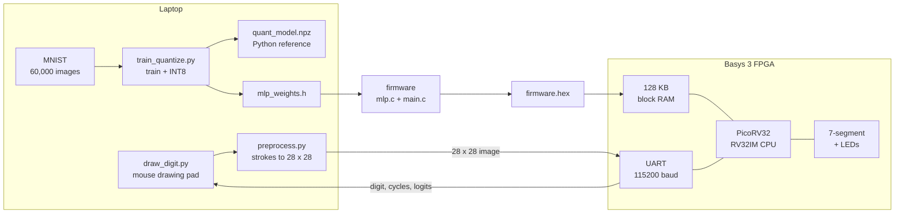
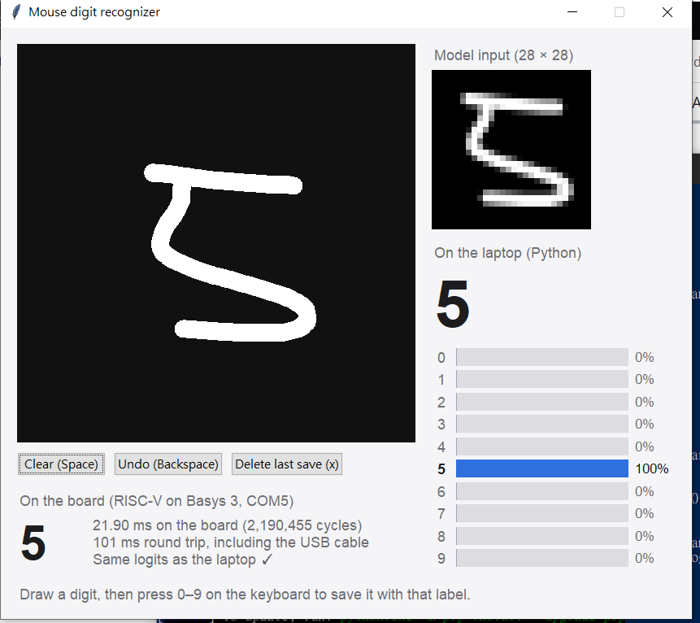
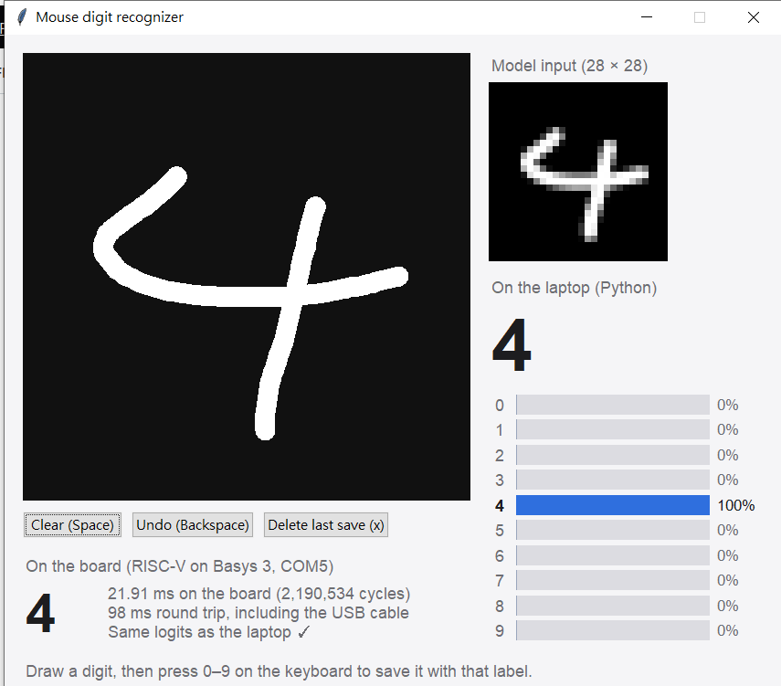

# EC601 Mouse Digit Recognition on RISC-V


[](https://github.com/RichardLitt/standard-readme)

Draw a digit with the mouse and have a RISC-V CPU on a Basys 3 FPGA recognize it, as the baseline for a neural-network accelerator.

This is my EC601 project (Boston University, Fall 2026). The project:

- trains a small neural network (MLP, 784 → 64 → 10) on MNIST and converts it
  to 8-bit integers,
- runs the same integer model in C on a PicoRV32 RISC-V CPU, checked bit for
  bit against Python at every step,
- simulates the whole system-on-chip in Verilator and measures the clock cycles
  per image (the CPU-only baseline),
- turns mouse drawings into MNIST-style 28 × 28 images and sends them to the
  board over the USB cable,
- next: adds a systolic-array accelerator next to the CPU and measures the
  speedup.

## Table of Contents

- [Security](#security)
- [Background](#background)
- [Install](#install)
- [Usage](#usage)
  - [1. Train and quantize](#1-train-and-quantize)
  - [2. Check C against Python](#2-check-c-against-python)
  - [3. Simulate the RISC-V SoC](#3-simulate-the-risc-v-soc)
  - [4. Drawing pad](#4-drawing-pad)
  - [5. Test on your own drawings](#5-test-on-your-own-drawings)
- [FPGA Deployment](#fpga-deployment)
  - [Troubleshooting](#troubleshooting)
- [Demo Results](#demo-results)
- [Repository Structure](#repository-structure)
- [Known Limitations](#known-limitations)
- [API](#api)
- [Maintainers](#maintainers)
- [Thanks](#thanks)
- [Contributing](#contributing)
- [License](#license)

## Security

Everything runs on your own computer and the Basys 3 board.

- Network: only `model/train_quantize.py` and `host/board_test.py` use it, to
  download the MNIST dataset from the mirrors listed in `train_quantize.py`.
  Every file is checked against its MD5 checksum.
- The board is reached only through its USB-UART serial port.
- Files are written only inside the repository: `model/` (dataset and trained
  model), `firmware/` (weights, test data, build output), `sim/obj_dir/`,
  `hw/build/` and `host/my_digits/` (saved drawings).

## Background

The goal is to measure how much a hardware accelerator speeds up neural-network
inference on a small CPU, with a demo anyone can try: draw a digit, and the
board recognizes it. Before building the accelerator, the project needs:

- a model small enough to fit in the FPGA's on-chip memory,
- integer-only arithmetic, since the CPU has no floating-point unit,
- a CPU-only baseline measured in clock cycles,
- a way to prove that every stage gives exactly the same answer, so the
  accelerator can be checked the same way later.



The same RTL also runs in Verilator (`sim/`), where a C++ testbench plays the
role of the laptop.

### Key design decisions

- **Integer-only model.** Weights are INT8, sums are INT32, and the input is
  `pixel >> 1` (0 to 127). The hidden layer is scaled back to 8 bits with a
  fixed-point multiplier instead of a float:
  `h = clamp((acc * M1 + 2^40) >> 41, 0, 127)` with `M1 = 1628640033`; the
  clamp at 0 is the ReLU. Accuracy is 97.72% in float and 97.73% in INT8, and
  the accelerator will use the same arithmetic.
- **One golden reference.** `model/qmlp.py` does the same integer math in NumPy.
  Every later stage is compared with it logit by logit, not only by the
  predicted digit: C on the laptop, the firmware in simulation, and the
  firmware on the board.
- **Same C code everywhere.** `mlp.c` is freestanding (no libc, no floating
  point), so the exact file tested on the laptop runs on the RISC-V CPU.
- **Fair CPU baseline.** PicoRV32 is configured as RV32IM with the hardware
  multiplier (DSP slices) and the barrel shifter turned on. The firmware reads
  the cycle counter (`rdcycle`) right before and after `mlp_infer()`, so the
  cycle count covers inference only, not the UART transfer.
- **One protocol for simulation and board.** The testbench and the host tools
  use the same UART protocol, so a test that passes in simulation runs
  unchanged on the board. Simulation only shortens each bit (16 clocks instead
  of 868) to run faster.
- **MNIST-style preprocessing.** Mouse strokes are drawn with a pen width
  relative to the drawing size, cropped, scaled so the longest side is 20 px,
  and centered by center of mass in a 28 × 28 image, the way MNIST was made.
  Drawing big or small, or in a corner, gives the same input.

## Install

Requirements:

- Python 3.9 or newer with NumPy. Tkinter for the drawing pad (included with
  Python on Windows; on a Mac with Homebrew Python: `brew install python-tk@3.14`,
  matching your Python version).
  pyserial to talk to the board. Tested with Python 3.12 to 3.14.
- A RISC-V cross compiler (`riscv64-elf-gcc` or `riscv64-unknown-elf-gcc`) and
  a host C compiler, to build the firmware and the C test.
- Verilator 5, for the simulation.
- AMD Vivado (tested with 2026.1) and a Digilent Basys 3 board.

```bash
git clone https://github.com/ianpeng-hw/Ec601_mouseRISCV.git
cd Ec601_mouseRISCV
python3 -m venv .venv && source .venv/bin/activate    # Windows: .venv\Scripts\activate
pip install numpy pyserial
brew install riscv64-elf-gcc verilator                 # Ubuntu: sudo apt install gcc-riscv64-unknown-elf verilator
```

## Usage

Run the commands from the repository folder.

### 1. Train and quantize

```bash
cd model
python3 train_quantize.py
cd ..
```

Downloads MNIST (about 11 MB), trains for 20 epochs (about 30 seconds), and
converts the model to INT8. It writes `firmware/mlp_weights.h` (weights for C),
`firmware/test_data/` (test images and Python's answers), and
`model/quant_model.npz` (the model for the drawing pad and the host tools).

```
  epoch 20/20  test acc 97.72%  (0.6s)
Quantizing to INT8
  float accuracy 97.72%   int8 accuracy 97.73%
  M1 = 1628640033 * 2^-41
```

### 2. Check C against Python

```bash
make -C firmware test
```

```
C vs Python: 10000 / 10000 images identical
C accuracy:  97.73%
PASS: C matches Python bit for bit
```

### 3. Simulate the RISC-V SoC

```bash
make -C firmware          # builds firmware/build/firmware.hex
make -C sim run           # 20 MNIST test images
make -C sim run N=200     # more images
```

Verilator simulates the whole SoC running the firmware. The testbench sends
each image over UART, checks the 10 logits against Python, and reports the
cycles the firmware measured:

```
Logits identical to Python: 20 / 20 images
Correct digits:             20 / 20
Cycles per inference:       2190525 (min 2190467, max 2190601)
Time per inference:         21.91 ms at 100 MHz
PASS: the RISC-V SoC matches Python bit for bit
```

The cycle count can differ by a fraction of a percent between compiler
versions; the logits must always match.

### 4. Drawing pad

```bash
python3 host/draw_digit.py            # recognize on the laptop
python3 host/draw_digit.py --board    # also send each drawing to the Basys 3
```

The window shows the 28 × 28 image the model sees, the prediction and the
confidence for each digit. The laptop uses the same integer model as the
firmware, so its answer is the board's answer.

| Key / mouse | Action |
|---|---|
| Drag with the left button | Draw |
| Space or Delete | Clear |
| Backspace or `u` | Undo the last stroke |
| `0`-`9` | Save the drawing with that label to `host/my_digits/`, then clear |
| `x` | Delete the last saved drawing (pressed the wrong digit) |

With `--board` (or `--port COM5`), each finished stroke is sent to the board.
The window then also shows the board's answer, its inference time from the
cycle counter, the round-trip time including the USB cable, and whether the
board's logits match the laptop's.

### 5. Test on your own drawings

```bash
python3 host/eval_my_digits.py     # accuracy on the drawings saved in host/my_digits/
python3 host/test_preprocess.py    # checks the preprocessing (no window needed)
```

Saved drawings keep the raw strokes, so after changing the preprocessing or
retraining, `eval_my_digits.py` re-runs everything on the same drawings.
`test_preprocess.py` enlarges and moves MNIST test digits like mouse drawings
and checks that accuracy stays the same (reference: 97.50% → 97.65%).

## FPGA Deployment

### 1. Copy the firmware for Vivado

Vivado reads the firmware from `hw/firmware.mem`, a copy of
`firmware/build/firmware.hex`. It must come from the same training run as
`model/quant_model.npz`, so update it after every retraining or firmware change
(on the computer with the RISC-V compiler) and commit it:

```bash
make -C firmware && cp firmware/build/firmware.hex hw/firmware.mem
```

### 2. Build the bitstream

**Option A: Vivado GUI.**

1. **Create Project**. Project name `vivado`, location: the repository folder
   (for example `C:/Users/<you>/Documents/EC601/Ec601_mouseRISCV`), with
   "Create project subdirectory" checked. The project goes into `vivado/`,
   which git ignores.
2. Choose **RTL Project**. Add as design sources `hw/rtl/picorv32.v`,
   `hw/rtl/soc.v`, `hw/rtl/uart.v`, `hw/rtl/basys3_top.v` and
   `hw/firmware.mem`, with **Copy sources into project** unchecked, so a
   `git pull` updates the project too.
3. Add `hw/constraints/basys3_soc.xdc` as the constraint file.
4. Choose the part **xc7a35tcpg236-1**.
5. Make sure `basys3_top` is the top module (bold in the Sources window).
6. **Generate Bitstream**. In the Messages window,
   `$readmem data file 'firmware.mem' is read successfully` must appear;
   otherwise the RAM is empty and the CPU runs nothing. The Project Summary
   should show a positive WNS (timing met at 100 MHz).

**Option B: Tcl script.** In the Vivado Tcl Shell, or the Tcl Console with no
project open (paths use `/`, also on Windows):

```
cd C:/path/to/Ec601_mouseRISCV/hw
source build.tcl
```

`build.tcl` reads the RTL, the constraints and `firmware.mem`, runs synthesis
and implementation for the **xc7a35tcpg236-1**, and writes
`hw/build/basys3_soc.bit` with timing and utilization reports. It ends by
printing whether timing is met at 100 MHz.

### 3. Program the board

Plug the micro-USB cable into the PROG/UART port and switch the board on.

- GUI: **Open Hardware Manager** -> **Open Target** -> **Auto Connect** ->
  **Program Device**.
- Script: `source program.tcl`.

If Vivado finds no hardware target, check that Windows sees the board: Device
Manager should list *USB Serial Converter A* and *B*. An *Unknown USB Device*
means a bad connection or a charge-only cable.

The FPGA forgets its design when it loses power, so program it again after
every power-up.

### 4. Run the test images on the board

```bash
python3 host/board_test.py            # 100 MNIST test images
python3 host/board_test.py -n 1000
python3 host/board_test.py --list     # show serial ports if the board is not found
```

The output has the same format as the simulation, plus the round-trip time
measured on the laptop (USB-UART both ways plus inference).

### 5. Draw on the board

```bash
python3 host/draw_digit.py --board
```

### Board mapping

| Board | Function |
|---|---|
| Center button (BTNC) | Reset the CPU |
| Micro-USB (PROG/UART) | Programming, and UART at 115200 baud, 8N1 |
| Rightmost 7-segment digit | Last recognized digit |
| LD0-LD9 | LD*n* on when the last digit was *n* |
| LD15 | CPU trap (error); should stay off |

### UART protocol

All numbers are little-endian.

| Direction | Bytes | Meaning |
|---|---|---|
| Laptop → board | `'P'` | Ping |
| Board → laptop | `'K'` | Ping reply |
| Laptop → board | `'I'` + 784 | 28 × 28 image, row by row, 0 = background |
| Board → laptop | `'R'`, digit (1), cycles (uint32), 10 logits (int32) | 46-byte result |

### Memory map

| Address | Register |
|---|---|
| `0x0000_0000` - `0x0001_FFFF` | 128 KB RAM: program, weights and stack, loaded from `firmware.mem` |
| `0x1000_0000` | UART data: write sends a byte, read returns the received byte |
| `0x1000_0004` | UART status: bit 0 = transmitter busy, bit 1 = byte received |
| `0x1000_0008` | LEDs (bits 15:0) |
| `0x1000_000C` | 7-segment: bits 15:0 = four hex digits, bits 19:16 = digits turned on |

### Troubleshooting

**`hw/firmware.mem` disappeared.** After the first build on Windows,
`hw/firmware.mem` was missing from the cloned repository. The Vivado log showed
that the build had read it (`$readmem data file 'firmware.mem' is read
successfully`), so that bitstream was fine and the file was removed afterwards.
The script had been run while a Vivado GUI project was open, which adds
`firmware.mem` to that project's sources; most likely it was then removed from
the project with the option to also delete it from disk. The fix was to
restore it from git:

```
git restore hw/firmware.mem
```

To avoid it, run `build.tcl` with no project open, and in a GUI project never
remove `firmware.mem` with "delete from disk". Two safety nets catch a missing
file: `build.tcl` stops with an error before synthesis, and in the GUI flow the
Messages window lacks the `read successfully` line. A bitstream built without
the file has an empty RAM, so the CPU traps right after reset and LD15 lights
up.

## Demo Results

The whole pipeline runs on the Basys 3. A digit drawn with the mouse is sent
over the USB cable, the RISC-V CPU on the FPGA recognizes it, and its 10 logits
match the laptop's bit for bit.

<table>
  <tr>
    <td align="center"><br>
      Drawn 5: the board answers 5 in 21.90 ms (2,190,455 cycles)</td>
    <td align="center"><br>
      Drawn 4: the board answers 4 in 21.91 ms (2,190,534 cycles)</td>
  </tr>
</table>

`board_test.py` on the Basys 3, with the first 100 MNIST test images:

```
Board on COM5 answered the ping. Running 100 MNIST test images...
  image 0: label 7, board says 7, 2190467 cycles, logits match Python
  image 1: label 2, board says 2, 2190498 cycles, logits match Python
  image 2: label 1, board says 1, 2190469 cycles, logits match Python
  image 3: label 0, board says 0, 2190560 cycles, logits match Python
  image 4: label 4, board says 4, 2190553 cycles, logits match Python
  ...
Logits identical to Python: 100 / 100 images
Correct digits:             100 / 100
Cycles per inference:       2190520 (min 2190419, max 2190618)
Time per inference:         21.91 ms on the board (100 MHz)
Round trip per image:       95.9 ms measured on this computer (USB-UART both ways + inference)
PASS: the board matches Python bit for bit
```

Every stage so far:

| Stage | Check | Result |
|---|---|---|
| Training | MNIST test accuracy (float) | 97.72% |
| Quantization | MNIST test accuracy (INT8) | 97.73% |
| C on the laptop | Logits identical to Python | 10,000 / 10,000 images |
| RISC-V SoC, Verilator | Logits identical to Python | 20 / 20 images |
| RISC-V SoC, Basys 3 | Logits identical to Python | 100 / 100 images |
| RISC-V SoC, Basys 3 | Cycles per image (CPU only) | 2,190,520 = 21.9 ms at 100 MHz |
| RISC-V SoC, Basys 3 | Round trip including USB-UART | 95.9 ms |
| FPGA resources | Used / available | 1,250 / 20,800 LUTs, 819 / 41,600 FFs, 32 / 50 block RAMs, 4 / 90 DSPs |
| Timing | Worst slack at 100 MHz | +2.16 ns (met) |
| Firmware | Code + weights | about 52 KB of the 128 KB RAM |

The board's cycle count matches the Verilator simulation (2,190,525) to within
0.01%, so the simulation can be trusted for measuring the accelerator too.

Where the time goes: one image needs 784 × 64 + 64 × 10 = 50,816
multiply-adds, about 43 cycles each on PicoRV32 (8 instructions per
multiply-add in the inner loop, 4 to 5 cycles per instruction). This is the
work the accelerator will take over. Of the 95.9 ms round trip, about 68 ms is
sending the image over UART (785 bytes × 10 bits at 115,200 baud), about 4 ms
the 46-byte reply, and 21.9 ms the inference, so the accelerator's speedup is
measured on the cycle counter, separately from the transfer.

## Repository Structure

```
Ec601_mouseRISCV/
├── model/
│   ├── train_quantize.py   # download MNIST, train the MLP, quantize to INT8, export weights and test data
│   ├── qmlp.py             # integer inference in NumPy: the golden reference
│   ├── quant_model.npz     # trained INT8 model
│   └── quant_info.json     # training settings, accuracy and scale factors
├── firmware/
│   ├── mlp.c, mlp.h        # integer inference in C: mlp_infer()
│   ├── mlp_weights.h       # INT8 weights as C arrays (generated)
│   ├── main.c              # UART protocol, timing with rdcycle, 7-segment and LEDs
│   ├── start.S, link.ld    # boot code and memory layout
│   ├── libc.c              # memset and memcpy (there is no C library)
│   ├── makehex.py          # binary to $readmemh hex
│   ├── test_mlp.c          # C vs Python test on the laptop
│   └── Makefile            # make: firmware; make test: C vs Python
├── hw/
│   ├── rtl/
│   │   ├── picorv32.v      # PicoRV32 RISC-V CPU (YosysHQ, unmodified)
│   │   ├── soc.v           # CPU + 128 KB RAM + UART + LED and 7-segment registers
│   │   ├── uart.v          # UART transmitter and receiver
│   │   ├── basys3_top.v    # board top level: clock, reset button, 7-segment scanning
│   │   └── sw_led.v        # switch-to-LED test for checking the Vivado flow
│   ├── constraints/
│   │   ├── basys3_soc.xdc     # pins and 100 MHz clock for the SoC
│   │   └── basys3_sw_led.xdc  # pins for the LED test
│   ├── build.tcl           # Vivado: build the bitstream
│   ├── program.tcl         # Vivado: program the board
│   └── firmware.mem        # firmware for Vivado (copy of firmware/build/firmware.hex)
├── sim/
│   ├── sim_main.cpp        # Verilator testbench: plays the laptop, checks logits, counts cycles
│   └── Makefile            # make run [N=...]
├── host/
│   ├── draw_digit.py       # mouse drawing pad (--board to use the FPGA)
│   ├── preprocess.py       # mouse strokes to an MNIST-style 28 x 28 image
│   ├── board.py            # serial link to the board
│   ├── board_test.py       # MNIST test images on the board vs Python
│   ├── eval_my_digits.py   # accuracy on my own saved drawings
│   ├── test_preprocess.py  # preprocessing checks
│   └── my_digits/          # saved drawings (raw strokes, JSON)
├── docs/
│   └── board_demo_*.png    # the drawing pad running on the board, used in this README
└── README.md
```

Generated and not committed: `model/data/` (MNIST), `firmware/test_data/`,
`firmware/build/`, `sim/obj_dir/`, `hw/build/` and `vivado/` (the Vivado GUI
project).

## Known Limitations

- Digits only, with a small MLP. Recognizing doodles (Quick, Draw!) will need a
  convolutional network.
- PicoRV32 is small and slow (about 4 cycles per instruction), so the speedup
  measured later is relative to this small CPU; a faster CPU would give a
  smaller speedup.
- UART at 115,200 baud takes longer to send an image than the CPU takes to
  recognize it.
- The design is lost when the board is switched off; it is not yet written to
  the board's flash memory.
- `hw/firmware.mem` is updated by hand after retraining. If it comes from a
  different training run than `model/quant_model.npz`, `board_test.py` reports
  that no logits match.

## API

The modules can also be used from Python without the drawing pad:

```python
import sys
sys.path += ["model", "host"]

import numpy as np
from qmlp import QuantMLP
from board import Board

model = QuantMLP.load("model/quant_model.npz")
img = np.fromfile("firmware/test_data/test_images.bin", np.uint8)[:784]   # first test image
print(model.predict(img))                       # [7]

with Board() as b:                              # finds the Basys 3 by itself
    r = b.infer(img)
    print(r.digit, r.cycles, r.compute_ms)      # 7, about 2.19 million cycles, about 21.9 ms
```

| File | Function | Returns |
|---|---|---|
| `model/qmlp.py` | `QuantMLP.load(path)` | the integer model |
| `model/qmlp.py` | `model.logits(img)`, `model.predict(img)` | int64 logits, shape (N, 10); predicted digits |
| `host/preprocess.py` | `strokes_to_mnist(strokes)` | uint8 28 × 28 image, or `None` for an empty drawing |
| `host/preprocess.py` | `to_mnist(raster)` | uint8 28 × 28 image from a grayscale drawing of any size |
| `host/board.py` | `Board(port=None)`, `board.ping()` | serial link; `True` if the board answers |
| `host/board.py` | `board.infer(img)` | `Result` with `digit`, `cycles`, `logits`, `compute_ms`, `round_trip_ms` |
| `firmware/mlp.h` | `int mlp_infer(const uint8_t img[784], int32_t logits[10])` | predicted digit; fills `logits` if not `NULL` |

## Maintainers

- Ian Peng ([@ianpeng-hw](https://github.com/ianpeng-hw))
-
- 

## Thanks

- [PicoRV32](https://github.com/YosysHQ/picorv32) by Claire Xenia Wolf and YosysHQ.
- The [MNIST database](https://yann.lecun.com/exdb/mnist/) by Yann LeCun,
  Corinna Cortes and Christopher J. C. Burges.
- [Verilator](https://www.veripool.org/verilator/), for fast simulation of the
  whole SoC.

## Contributing


## License

Coursework for EC601 at Boston University, Fall 2026. No open-source license is
granted; all rights reserved by the author. `hw/rtl/picorv32.v` is third-party
code by Claire Xenia Wolf, distributed under the ISC license in its header.
